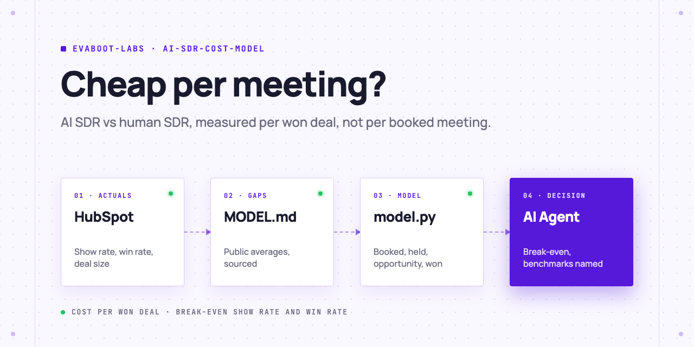
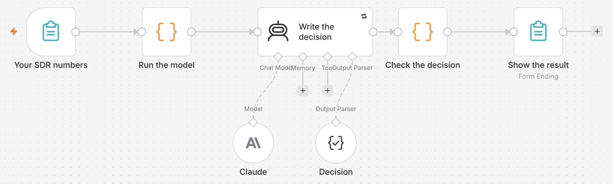

<picture>
  <source media="(prefers-color-scheme: dark)" srcset=".github/assets/banner-dark.png">
  
</picture>

# AI SDR cost model

Your AI Agent compares an AI SDR and a human SDR on what matters: cost per won deal, not cost per booked meeting. It reads your show rate, win rate and deal size from HubSpot when you have the history, fills the gaps with sourced public averages, and tells you the break-even.

[](AGENTS.md)
[](https://evaboot.com/mcp)
[](LICENSE)

## Set it up in one prompt

Paste this into Claude Code, Codex or Cursor:

```text
Clone https://github.com/evaboot-labs/ai-sdr-cost-model, read AGENTS.md and follow the skill. Is an AI SDR cheaper than our SDRs per won deal?
```

<details>
<summary>Or install the skill</summary>

Claude Code:

```text
/plugin marketplace add evaboot-labs/ai-sdr-cost-model
/plugin install ai-sdr-cost-model@evaboot-labs-ai-sdr-cost-model
```

Codex, Cursor and other agents:

```bash
npx skills add evaboot-labs/ai-sdr-cost-model
```

</details>

## How it works

**1. Your numbers first.** `model.py actuals` reads 12 months of HubSpot meetings and deals. With 20 or more of each, it gives your own show rate, win rate and deal size.

**2. Public averages for the gaps.** Every other input in [`MODEL.md`](MODEL.md) is a sourced average (RevPartners, Salesmotion, Unify), marked `# benchmark` until you replace it.

**3. The whole funnel.** `model.py run` follows a month of meetings to won deals, for each side:

```text
$ python3 model.py run > queue/model.json
                         human      AI
cost per booked            694     168
cost per held              926     335
cost per opportunity      2205    1117
cost per won deal        11023   11167
break-even AI show rate 0.51, AI win rate 0.101
```

On the public averages, the AI SDR is 4 times cheaper per booked meeting and a little dearer per won deal. Half its meetings do not happen, and fewer of the rest close.

**4. A decision that names its sources.** Your agent writes it; `model.py check` rejects one that hides the cost per won deal or presents a benchmark as your number.

**5. Or give your team a form.** The n8n version asks for the same numbers and shows the same result.



## What you need

- An AI Agent: Claude Code, Codex, Cursor, or n8n for the form.
- Optional: a HubSpot private app or service key with contact and deal read scopes, for your own rates.
- Python 3.9+, with no packages to install.

## Go further

| Page | For |
|---|---|
| [docs/connect-your-agent.md](docs/connect-your-agent.md) | The key and the setup by hand |
| [docs/n8n.md](docs/n8n.md) | The model as a form for your team |
| [MODEL.md](MODEL.md) | Every input, its public average and its source |

---

Agents: start at [AGENTS.md](AGENTS.md) · Built by [Evaboot](https://evaboot.com) · More workflows at [github.com/evaboot-labs](https://github.com/evaboot-labs) · [MIT license](LICENSE)
